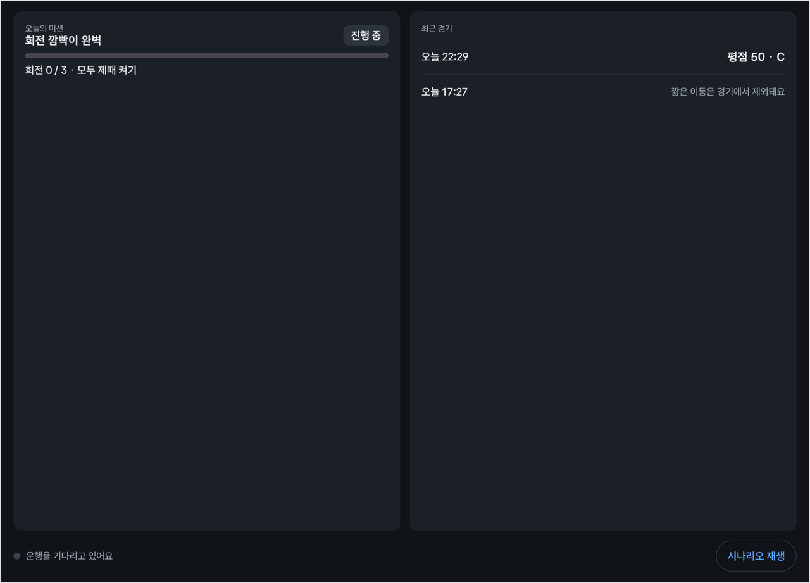
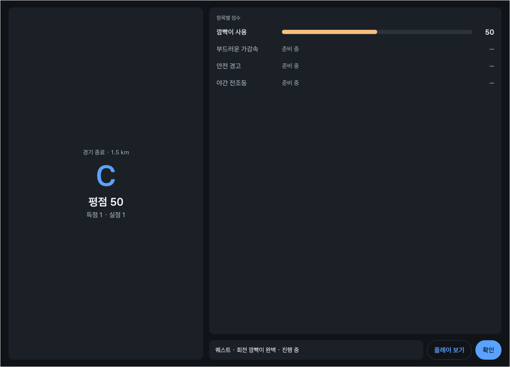
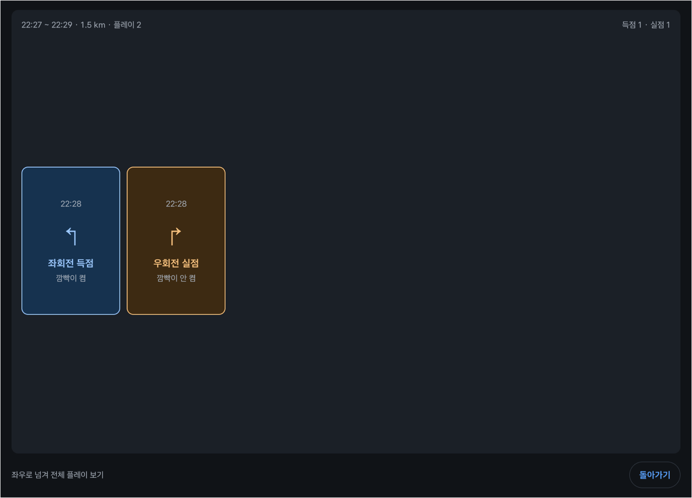
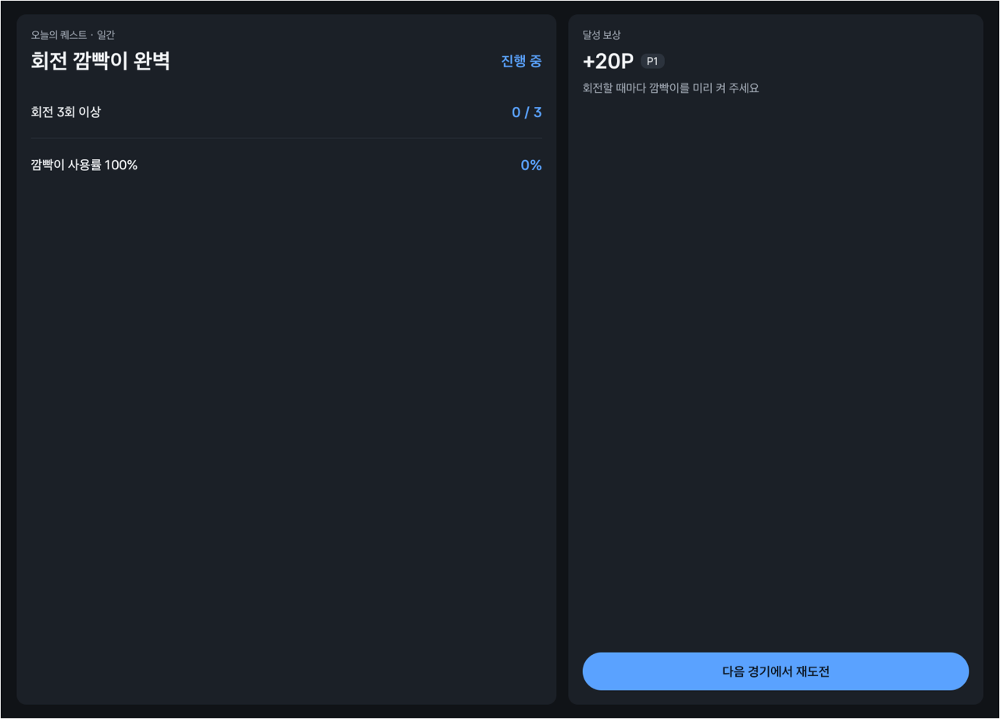
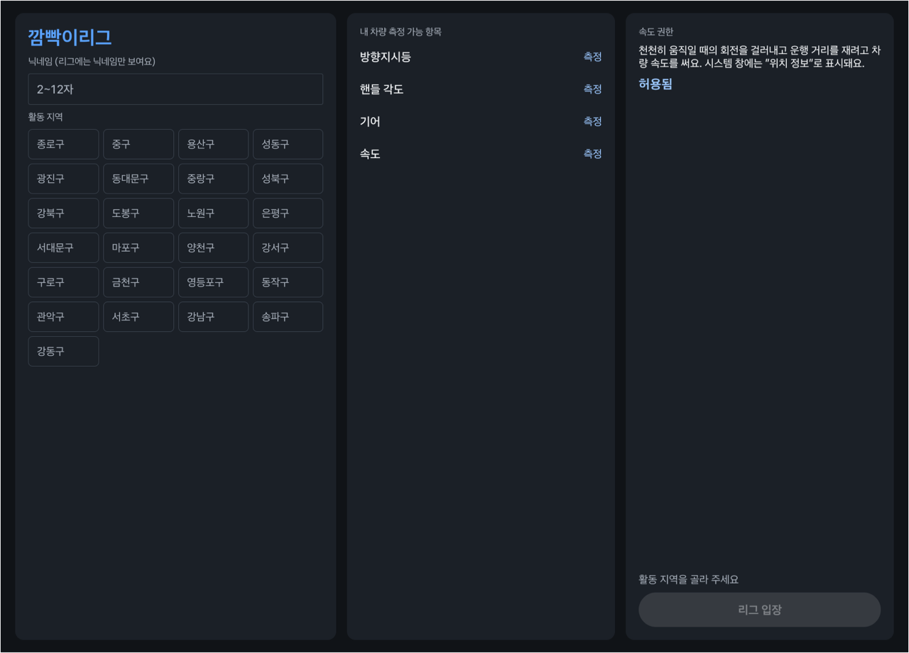

# BlinkerLeague

> 회전할 때 깜빡이를 제때 켰는지 운행마다 판정해 경기처럼 점수·퀘스트로 돌려주는 Android Automotive 앱 (깜빡이리그, Pleos 공모전 출품작)

| 홈 | 경기 결과 | 플레이 타임라인 |
| --- | --- | --- |
|  |  |  |
| **퀘스트** | **온보딩** | |
|  |  | |

> Pleos Connect 에뮬레이터의 앱 영역(1682×1210dp) 캡처

## ✅ 해야 할 일 (1차 제출 전)

- [ ] **출시 키 만들기·보관**: 아래 "6. 출시용(release) APK"의 `keytool` 명령으로 키를 만들고 `local.properties`에 4줄을 적습니다. 키 파일과 비밀번호는 저장소에 올리지 말고 따로 보관합니다(잃어버리면 같은 앱으로 업데이트할 수 없음).
- [ ] 시연 영상: "좌회전 깜빡이 성공 → 우회전 실패 → 운행 종료 → 점수·퀘스트 화면"
- [ ] 공모전 제출 양식 작성

## 📌 주요 기능

- **운행 자동 기록**: 기어가 D·R·N이 되면 운행을 시작하고, P단 3분이면 끝냅니다. 앱이 화면에 없어도 포그라운드 서비스로 기록합니다.
- **회전·깜빡이 판정**: 핸들 각도로 회전을 찾고, 회전 시작 5초 전부터 같은 방향 깜빡이를 켰는지 판정합니다. 지원하지 않는 신호는 0점이 아니라 측정에서 제외합니다.
- **경기 결과와 퀘스트**: 정차 후 평점·등급, 득점(켠 회전)·실점(안 켠 회전), 플레이 타임라인, 오늘의 퀘스트 진행도를 보여줍니다.
- **주행 안전**: 주행 중에는 점수 화면을 띄우지 않고 "기록 중" 화면만 보여줍니다. 음성은 시동 때 퀘스트 안내, 운행 종료 때 결과 한마디만 합니다.
- **오프라인 우선**: 판정은 기기에서 하고 결과를 먼저 저장합니다. 서버 업로드는 연결되면 자동으로 다시 보냅니다. 원시 위치 좌표는 서버로 보내지 않습니다.

## 🛠 기술 스택

| 구분 | 내용 |
| --- | --- |
| Language | Kotlin 1.9.22 |
| Platform | Android Automotive OS (minSdk 28 / targetSdk 34) |
| Build | Gradle (Kotlin DSL), AGP 8.2.2 |
| Vehicle SDK | Pleos Playground Vehicle SDK 2.3.2, TextToSpeech 3.3.1, FusedLocation 1.1.3, CarPropertyManager(속도) |
| Architecture | MVVM + Jetpack Compose, 수동 DI(`AppContainer`) |
| Data | Room(운행·이벤트 선저장), WorkManager(업로드 재전송), Retrofit + OkHttp + kotlinx.serialization |
| Test | JUnit4, kotlinx-coroutines-test, Robolectric, MockWebServer |

## 🚀 시작하기

### 요구 환경

| 항목 | 필요한 것 | 비고 |
| --- | --- | --- |
| Android Studio | 최신 버전 | |
| JDK | **17** | Android Studio에 들어 있는 JDK(최근 버전은 21~25)로는 Gradle 8.2가 돌지 않음 |
| Android SDK | Platform **API 34**, Build-Tools 34 | 첫 빌드 때 Gradle이 자동으로 설치함 (SDK 라이선스에 동의돼 있어야 함) |
| 시스템 이미지 | **Pleos Connect v2.1.0 (API 34)** | 일반 폰·Automotive 이미지로는 Vehicle SDK가 동작하지 않음 |
| Vehicle / TTS SDK | `ai.pleos.playground:Vehicle`, `TextToSpeech` | Pleos Nexus에서 자동으로 받음. **인증 없이 받을 수 있음** |
| 가속 | Windows: WHPX(Windows 하이퍼바이저 플랫폼) | `emulator -accel-check`로 확인 |

### 1. 경로에 한글이 없도록 하기 (Windows 필수)

Windows 사용자 이름이 한글이면(`C:\Users\홍길동\...`) 빌드나 테스트가 실패합니다.

| 증상 | 원인 |
| --- | --- |
| `Your project path contains non-ASCII characters` | 프로젝트 경로에 한글이 들어 있음 |
| `testDebugUnitTest`에서 `Could not write standard input to Gradle Test Executor` | Gradle 캐시(`C:\Users\<한글>\.gradle`) 경로에 한글이 들어 있음 |

**두 가지를 모두** 영문 경로로 옮겨야 합니다. 프로젝트만 옮기면 테스트는 계속 실패합니다.

```powershell
# 1) 프로젝트를 영문 경로에 clone (예: C:\dev)
git clone <저장소 URL> C:\dev\blinkerleague\android-app

# 2) Gradle 캐시 위치를 영문 경로로 지정 (한 번만 하면 됨. 설정 후 Android Studio와 터미널을 다시 열 것)
setx GRADLE_USER_HOME C:\gradle-home
```

> Android SDK 경로(`C:\Users\<한글>\AppData\Local\Android\Sdk`)는 그대로 둬도 됩니다.
> `android.overridePathCheck=true`로 검사만 끄는 방법은 쓰지 마세요. APK 빌드는 되지만 단위 테스트가 실패합니다.

### 2. JDK 17 지정

- **Android Studio**: Settings → Build, Execution, Deployment → Build Tools → **Gradle** → **Gradle JDK**에서 JDK 17 선택
  (목록에 없으면 같은 메뉴에서 Download JDK → 버전 17)
- **터미널**에서 `./gradlew`를 쓸 때

  ```bash
  # macOS
  export JAVA_HOME=$(/usr/libexec/java_home -v 17)
  # Windows (Git Bash)
  export JAVA_HOME="/c/Program Files/Java/jdk-17.0.1"   # 설치된 경로에 맞게
  ```
  ```powershell
  # Windows (PowerShell)
  $env:JAVA_HOME = "C:\Program Files\Java\jdk-17.0.1"
  ```

> Android Studio가 AGP 업그레이드(Upgrade Assistant)를 권하더라도 팀 합의 없이 올리지 마세요. Kotlin·Compose 컴파일러 버전이 함께 맞물려 있습니다.

### 3. Pleos Connect 에뮬레이터 설치

Pleos Connect Emulator(v2.1.0, API 34) 시스템 이미지 설치, AVD 생성·실행, Virtual Console 사용법은
👉 **[docs/emulator-setup.md](docs/emulator-setup.md)** 를 참고하세요.

요약: SDK Manager → SDK Update Sites에 Pleos 이미지 URL 추가 → SDK Platforms에서 API 34의 **Pleos Connect** 이미지 설치 → Device Manager에서 Automotive / Pleos Connect v2.1.0 AVD 생성 (RAM 4GB, Cold boot)

```bash
# 에뮬레이터 실행 후 Virtual Console 사용
adb forward tcp:8088 tcp:8088   # 이후 http://127.0.0.1:8088/ 접속
```

> Windows에서 `adb`를 찾을 수 없다면 `%LOCALAPPDATA%\Android\Sdk\platform-tools`를 PATH에 추가하세요.

### 4. 빌드 및 실행

```bash
# 디버그 빌드
./gradlew :automotive:assembleDebug

# 실행 중인 Pleos 에뮬레이터에 설치
./gradlew :automotive:installDebug

# 단위 테스트
./gradlew :automotive:testDebugUnitTest
```

Android Studio에서는 상단 기기 목록에서 `Pleos_Connect_v2.1.0_API_34`를 고르고 **Run ▶**(`automotive` 구성)을 누르면 됩니다.

### 5. 화면 확인 방법

| 방법 | 용도 | 에뮬레이터 필요 |
| --- | --- | --- |
| **Compose Preview** | 화면 디자인만 빠르게 확인. `HomeScreen.kt`, `ResultScreen.kt`, `PlaysScreen.kt`, `QuestScreen.kt`, `OnboardingScreen.kt`, `DrivingScreen.kt`를 열고 Split/Design 탭 | ✗ |
| **시나리오 재생 (디버그 빌드)** | 홈 아래 "시나리오 재생" → "시연: 좌회전 성공 → 우회전 실패" 10배속 → 몇 초 뒤 경기 결과(득점 1 · 실점 1) | ✓ |
| **Virtual Console** | 기어·속도·방향지시등·핸들 각도를 브라우저에서 바꿔 가며 실제 신호로 확인 (기어 D면 "기록 중" 화면) | ✓ |

- 처음 실행하면 온보딩(닉네임·활동 지역)이 나옵니다. 서버 주소를 설정하지 않으면 Fake API로 동작합니다.
- 기어가 P가 아니면 정차 화면 대신 "기록 중" 화면이 나옵니다. 화면만 보려면 디버그 빌드에서 `adb shell am start -n com.example.blinkerleague/.MainActivity --ez guardBypass true`
- 실제 서버에 붙이려면 `local.properties`에 `blinker.serverUrl=http://10.0.2.2:8080` (에뮬레이터 → 내 PC)

> Pleos 화면에서 앱은 오른쪽 영역(에뮬레이터 1682×1210dp)에만 그려집니다. Preview는 1280×720과 좁은 폭(720)으로 확인합니다.

### 6. 출시용(release) APK

```bash
./gradlew :automotive:assembleRelease   # automotive/build/outputs/apk/release/
```

- 서명 키는 저장소에 넣지 않습니다. `local.properties`에 아래 4줄이 있으면 그 키로 서명하고, 없으면 서명하지 않은 APK가 나옵니다.

  ```properties
  blinker.release.storeFile=/절대/경로/blinkerleague-release.jks
  blinker.release.storePassword=…
  blinker.release.keyAlias=blinkerleague
  blinker.release.keyPassword=…
  ```
- 키 만들기: `keytool -genkeypair -v -keystore blinkerleague-release.jks -alias blinkerleague -keyalg RSA -keysize 2048 -validity 10000`
- 릴리스에는 조사용 코드·권한(`src/debug`)과 시나리오 재생 버튼이 들어가지 않습니다.

## 📁 프로젝트 구조

```
automotive/src/
├── main/java/com/example/blinkerleague/
│   ├── data/
│   │   ├── vehicle/     # Vehicle SDK·CarProperty 래퍼 (방향지시등·핸들 각도·기어·속도 → Flow), Fake 공급원
│   │   ├── location/    # Pleos FusedLocation 래퍼
│   │   ├── permission/  # 런타임 권한(속도·위치) 상태
│   │   ├── local/       # Room: 운행·이벤트 선저장, 업로드 대기열
│   │   ├── remote/      # API 인터페이스·DTO, Fake API, http/(Retrofit)
│   │   ├── auth/        # 등록 토큰 보관
│   │   ├── sync/        # WorkManager 업로드 재전송
│   │   ├── scenario/    # 시연·테스트용 신호 시나리오
│   │   └── repository/
│   ├── domain/
│   │   ├── model/       # Trip, TurnRecord, CapabilityReport 등 (Android 의존성 없음)
│   │   ├── detection/   # 운행 구분·회전 감지·깜빡이 판정·주행 안전 가드 (순수 함수)
│   │   ├── config/      # 기준값 (서버 설정으로 교체 가능)
│   │   └── region/      # 시군구 목록
│   ├── service/         # 운행 수집 포그라운드 서비스, 음성 안내 흐름
│   ├── voice/           # Pleos TextToSpeech 래퍼
│   └── ui/              # driving(주행 중), home, result(+plays), quest, onboarding, demo, theme, navigation
├── debug/               # 조사용 코드·권한 (릴리스 APK에 포함 안 됨)
└── release/             # DebugTools 빈 구현
```

- 작업 계획·결정 기록: [`plan.md`](plan.md), 화면 기준: [`docs/screen-plan.md`](docs/screen-plan.md), 플랫폼 확인표: [`docs/platform-capabilities.md`](docs/platform-capabilities.md)

## 🌿 브랜치 전략

| 브랜치 | 설명 |
| --- | --- |
| `main` | 배포 가능한 안정 버전 |
| `develop` | 다음 버전 개발 통합 브랜치 |
| `feature/기능명` | 기능 개발 (`develop`에서 분기) |
| `fix/버그명` | 버그 수정 |

- 작업은 `feature/*` 브랜치에서 진행한 뒤 `develop`으로 PR을 보냅니다.
- 머지 방식: **Squash merge** (PR당 커밋 1개로 `develop`에 반영, 머지 후 브랜치 삭제)

## 📝 커밋 컨벤션

```
<type>: <subject>

<body (선택)>
```

| Type | 설명 |
| --- | --- |
| `feat` | 새로운 기능 추가 |
| `fix` | 버그 수정 |
| `refactor` | 리팩토링 (기능 변화 없음) |
| `style` | 코드 포맷팅, 세미콜론 누락 등 (로직 변화 없음) |
| `docs` | 문서 수정 |
| `test` | 테스트 코드 추가/수정 |
| `chore` | 빌드 설정, 의존성, 기타 작업 |

**예시**

```
feat: 방향지시등 점등 이벤트 감지 추가
fix: 앱 재시작 시 점수가 초기화되는 문제 수정
```

- 제목은 50자 이내로 간결하게 작성합니다.
- 제목 끝에 마침표를 붙이지 않습니다.
- 이슈와 연결할 경우 본문에 `#이슈번호`를 적습니다.

## 🎨 코드 컨벤션

- [Kotlin 공식 코딩 컨벤션](https://kotlinlang.org/docs/coding-conventions.html)을 따릅니다.
- 클래스: `PascalCase` / 함수·변수: `camelCase` / 상수: `UPPER_SNAKE_CASE`
- 리소스 네이밍
  - 레이아웃: `activity_main.xml`, `fragment_home.xml`, `item_score.xml`
  - 아이콘·이미지: `ic_blinker.xml`, `img_background.webp`
  - 문자열 ID: `화면_용도` (예: `home_title`)
- 정적 분석: ktlint·detekt는 아직 쓰지 않습니다(plan.md "결정 필요"). Android lint(`./gradlew :automotive:lintDebug`) 오류 0을 유지합니다.
